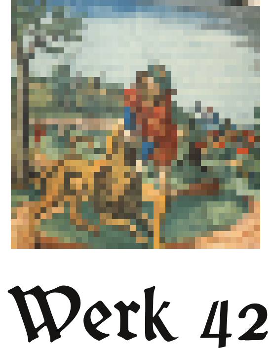
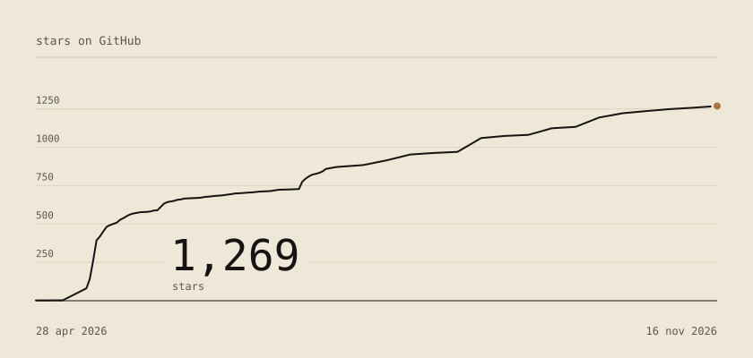

<a href="https://www.werk-42.eu">
  <picture>
    <source media="(prefers-color-scheme: dark)" srcset="https://raw.githubusercontent.com/nodes-app/.github/main/profile/assets/werk42/werk42-stacked-dark.png">
    
  </picture>
</a>

Werk 42 is the studio behind Nodes. 
<a href="https://www.werk-42.eu">www.werk-42.eu</a>

## Projects

### Nodes

A Mac app for writing and linking notes.

- Notes are Markdown and PDF files on your own disk, imported and exported as plain Markdown.
- `[[links]]` between notes, and a graph that lays them out.
- Tag suggestions and search by meaning run on the Mac, not on a server.

[Mac App Store](https://apps.apple.com/app/apple-store/id6745401961?pt=127809373&ct=github&mt=8) · [nodes-web.com](https://nodes-web.com) · [werk-42.eu/projects/nodes](https://www.werk-42.eu/projects/nodes/)

 

### swift-markdown-engine

The editor you type into in Nodes, as a Swift package for any Mac app: native AppKit on TextKit 2, bridged to SwiftUI. Open source under Apache 2.0.

[github.com/nodes-app/swift-markdown-engine](https://github.com/nodes-app/swift-markdown-engine) · [werk-42.eu/projects/swift-markdown-engine](https://www.werk-42.eu/projects/swift-markdown-engine/)

## Team

<table>
  <tr>
    <td align="center" width="180">
      <a href="https://github.com/Nicolas-Py">
         
        <b>Nico</b>
      </a> 
      @Nicolas-Py 
      Munich · TUM
    </td>
    <td align="center" width="180">
      <a href="https://github.com/luca-chen198">
         
        <b>Luca</b>
      </a> 
      @luca-chen198 
      Munich · LMU
    </td>
    <td align="center" width="180">
      <a href="https://github.com/xandaaaa">
         
        <b>Xander</b>
      </a> 
      @xandaaaa 
      Zurich · ETH
    </td>
  </tr>
</table>

